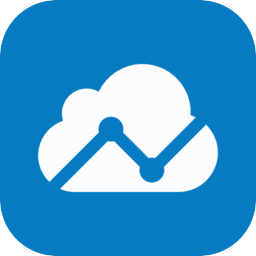
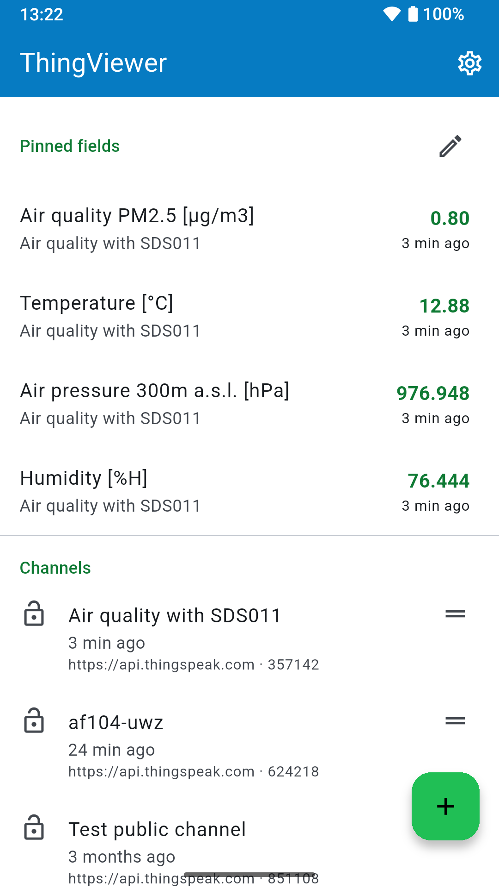
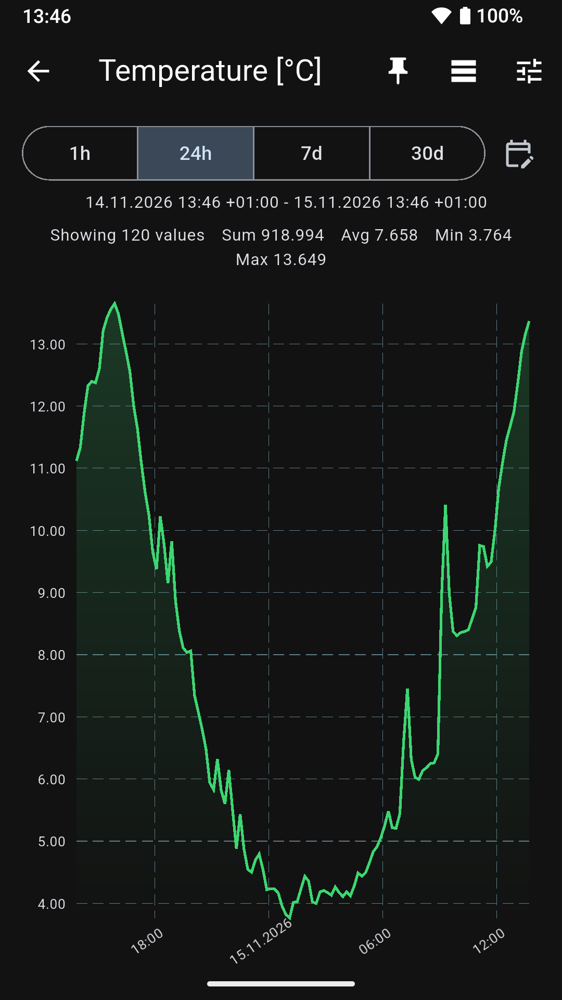
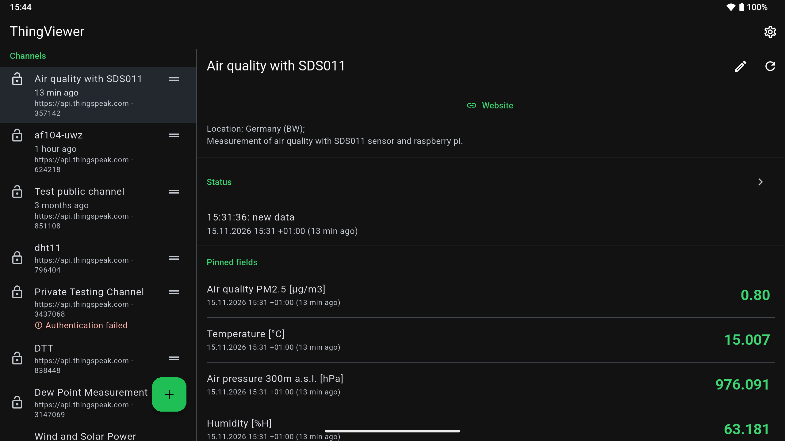

  

<h1 align="center">ThingViewer</h1>

View and chart your ThingSpeak channel data on Android.

  

  
  
  

  

ThingViewer is an open-source Android app, built with Flutter, for viewing and visualizing data from [ThingSpeak](https://thingspeak.com/) channels. You can also try the [web demo](https://janstol.github.io/ThingViewer/).

## Features

- Browse and manage multiple ThingSpeak channels, public or private (Read API Key), on api.thingspeak.com or a self-hosted server, with a configurable start screen (channel list or a chosen channel's detail screen)
- Pin the fields you check most; pinned fields show their latest value at the top of the channel list
- View latest field values per channel, its status messages, and its description and website/source links when set, with pull-to-refresh
- Last known values from a local cache show immediately, including offline, with a note on how old they are
- Charts for the last hour, 24 hours, 7 days or 30 days, or a custom range, as line, spline, step, or column charts, with minimum, maximum, average and sum for the shown range
- Per-field chart settings: title, axis labels, Y-axis min/max, decimal rounding, default range, min/max markers, and a "show change between readings" mode for counters
- Table of individual readings, with CSV export
- Automatically pages past ThingSpeak's per-request result cap so large date ranges aren't silently truncated; non-finite (`NaN`/`Infinity`) readings are skipped rather than breaking the chart
- Light / dark / system theme
- Configurable date and time formats, with an optional timezone indicator (offset or name)
- Export/import a full backup (saved channels, app settings, pinned fields, and per-field chart overrides) as a single JSON file, with a preview of what an import changes
- Responsive layout: list and detail side by side on tablets

## Installation

Google Play is the recommended source and gets automatic updates.

Each [GitHub Release](https://github.com/janstol/ThingViewer/releases/latest) also includes signed APKs (arm64-v8a and armeabi-v7a), for installing without the Play Store, e.g. on de-Googled Android (CalyxOS, GrapheneOS). Works with [Obtainium](https://github.com/ImranR98/Obtainium) for auto-updates.

The GitHub APKs are signed with a different key than the Play Store version (Play re-signs apps with its own key), so switching between the two isn't an in-place update: uninstall the old one first, then use Settings → Backup to carry your saved channels and settings across.

## Requirements

Android 7.0 (API 24) or newer.

## Development

See [`docs/development.md`](docs/development.md) for setup, running tests, release builds and the tech stack.

## License

[MIT](LICENSE)
